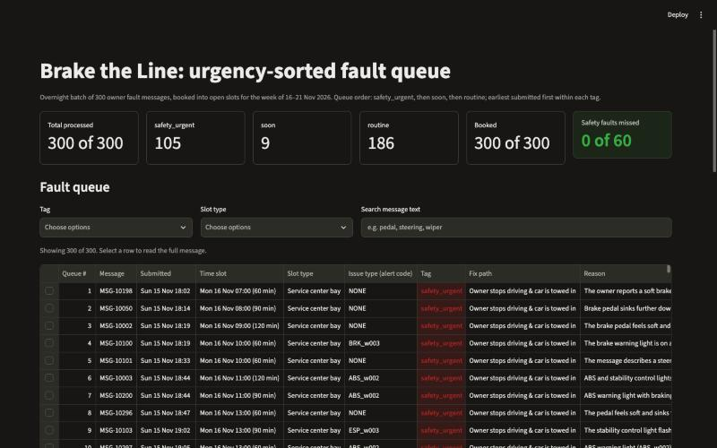
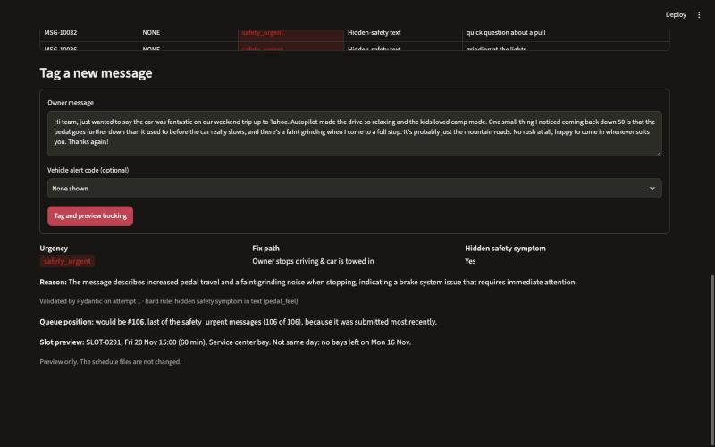

# Brake the Line: Tesla Service Fault Triage

Tesla Service currently answers owner fault messages in arrival order, so a soft brake pedal can wait days behind wiper and app-login questions. This project replaces that with an urgency-sorted queue. A language model tags each message, a strict Pydantic schema checks every answer, and a booking tool assigns a service slot. Brake and steering faults go to the front.

Project owner: Leilani Oyelaran, Senior Machine Learning Lead, Autopilot Perception.

## Key prompt

The rule that stops a calm, friendly message from hiding a brake or steering fault. It is sent to the model word for word ([triage/prompt.py](triage/prompt.py)):

> "Any message pertaining to the pedal/brake feel, stability, or steering must be tagged safety_urgent, whatever the tone and whatever the vehicle_alert_code. Calm, polite or apologetic wording does not lower the urgency: "no rush", "probably nothing" or "happy to wait" next to a soft pedal, a grinding brake, a pull to one side, heavy or shaky steering, or an unsettled or sliding car is still safety_urgent. When in doubt between safety_urgent and anything else, choose safety_urgent."

The schema enforces the same rule in code, so the prompt is not the only safeguard. If the model tags a brake or steering message `soon` or `routine`, its answer fails validation and goes back for a retry or gets flagged. It is never accepted as it is.

## Urgency rules (Stage 1)

| Urgency tag | Fix path(s) allowed |
|---|---|
| `safety_urgent` | `tow_in`: owner stops driving and the car is towed in |
| `soon` | `service_center_visit`: owner drives the car to a service center |
| `routine` | `mobile_remote_support`: mobile service or remote support |

**Change (17 Nov 2026):** I dropped the fourth fix path, `parts_order_then_visit`, for now, so each tag has exactly one fix path. A fourth path may be added again in a later stage.

**Safety alert list.** These `vehicle_alert_code` values always mean `safety_urgent`: `BRK_a001`, `BRK_w003`, `ABS_w002`, `ESP_w003`, `EPAS_a191`, `EPAS_w202`. The other five codes in the batch (`HVAC_w003`, `UI_a004`, `WIP_w001`, `CP_a004`, `NONE`) are left to the model and the text guard.

**Hidden-safety guard.** [triage/rules.py](triage/rules.py) also has pattern checks for symptoms such as a soft or sinking pedal, grinding through the pedal or wheels when stopping, pulling or tugging to one side, heavy, light or shimmying steering, and an unsettled or sliding car. If the text matches, the message must be `safety_urgent`. The patterns look for symptoms, not keywords, so "brakes feel normal" and wiper grinding do not trigger them.

**Bad records are rejected.** An input row with a missing, blank, extra or wrong-typed field (unknown alert code, bad `message_id`, non-numeric odometer and so on) is rejected and listed. It is never patched. The same goes for duplicate `message_id`s. A model answer with extra keys, an unknown tag, a fix path that doesn't fit its tag, or a non-boolean flag is rejected too.

## Current results

```
rows accepted: 300   rows rejected: 0
forced safety_urgent by alert code: 64
forced safety_urgent by hidden-safety text guard: 41
hand-checked safety messages missed by the rules: 0 of 60
```

## Tagging results (Stage 2)

`scripts/tag_batch.py` sends each message to the model through OpenRouter. It asks for structured output that matches the `TriageResult` schema, then checks every answer with Pydantic. An invalid answer goes back to the model with the validation error (up to 3 attempts). If it still fails, the message is flagged in `output/flagged_messages.csv`. It is never accepted as it is. Progress is saved after each message, so a stopped run picks up where it left off.

Model: `deepseek/deepseek-v4-flash`. Tagging all 300 messages cost about $0.01.

```
Tagged and validated: 300 of 300   flagged: 0   needed a retry: 0
By urgency:  safety_urgent 105, soon 9, routine 186
By fix path: Mobile service / remote support 186, Owner stops driving & car is towed in 105, Service center visit 9
Hand-checked safety messages not tagged safety_urgent: 0 of 60
```

- The model tagged all 105 safety messages `safety_urgent` on its first try. That's 64 caught by alert code and 41 by the hidden-safety guard. The schema didn't have to reject a single answer.
- The 9 `soon` messages are mostly suspension clunks, plus one charge-port latch and one range drop.
- The results are in `output/tagged_messages.csv`, sorted `safety_urgent`, then `soon`, then `routine`, oldest first within each tag. Each row has the tag, fix path, the model's reason and which hard rule (if any) required `safety_urgent`.

**Model history.** DeepSeek V4 Pro worked but cost about $0.03 per message. The free `nvidia/nemotron-3.5-super-vl:free` hit OpenRouter's free daily limit after 67 messages. V4 Flash was cheap and finished all 300 in one run, so every result comes from that one model.

## Booking and safety check (Stage 3)

`scripts/book_queue.py` books every tagged message into one slot from `data/Open Service Slots, Week of 16-21 November 2026.csv` (320 open slots, Mon 16 to Sat 21 Nov). The booking tool is in [triage/booking.py](triage/booking.py). Booking rules:

1. `safety_urgent` books first, into **service center bays**, on the booking day (Mon 16 Nov). When that day's bays run out, it carries into the earliest bay on the following day.
2. `soon` books next, into the service center bays left over.
3. `routine` books last. It takes **remote/OTA and support callback** slots first, then **mobile service visits**, then any **service center bays** still free.
4. Each slot holds one message. No `slot_id` is booked twice.

Within each tag, the oldest message books first. Slot rows with missing or wrong fields are rejected, the same as message rows.

```
Booked 300 of 300   waitlist 0   no slot booked twice
safety_urgent on Mon 16 Nov: 24 of 105, then Tue 17 Nov 34, Wed 18 Nov 42, Thu 19 Nov 5
routine: mobile visit 64, spare bay 60, remote/OTA 38, support callback 24
Safety check: 0 of 60 hand-checked safety messages missed
```

**Same-day limit.** Only 24 service center bays are open on Mon 16 Nov, but there are 105 `safety_urgent` messages. Same day for all of them isn't possible with these slots. They do take every bay from Monday to Thursday morning before any `soon` or `routine` message gets one.

**Routine overflow.** There are 186 `routine` messages but only 62 remote and callback slots. I chose to let routine spill into mobile visits and then spare bays, so all 300 are booked. The 60 routine messages in bays keep their tagged fix path.

**Output** (in `output/`):
- [`booking_report.md`](output/booking_report.md): the booking page and the safety check report. For every message it shows the time slot, slot type, issue type (alert code), tag and fix path. It also compares the tags with the 60 hand-checked safety messages and lists any misses.
- `service_schedule.csv`: the same bookings as data, with slot, bay and technician.
- `waitlist.csv`: messages with no slot left (empty this week).

`scripts/safety_check.py` runs the safety check on its own and exits with an error if anything was missed.

## Fault queue page (Stage 4)

```bash
.venv/bin/streamlit run app.py
```



[app.py](app.py) is a Streamlit page that brings Stages 1–3 together. It reads the Stage 2 and 3 output files and uses the code in `triage/` for all rules, tagging and booking, so nothing is worked out twice.

**Queue order:** by urgency (`safety_urgent`, then `soon`, then `routine`), then **earliest submitted first** within each tag, using `received_at`. Ties are broken by `message_id`. The page and the booking tool share one function (`triage.booking.queue_order`), so they always agree.

The page, top to bottom:
1. **Count bar:** total processed (300 of 300), `safety_urgent` / `soon` / `routine` counts, booked (300 of 300) and safety faults missed (0 of 60). The missed count is green at 0 and red above 0.
2. **Fault queue:** every message in queue order, with queue #, message, submitted time, time slot, slot type, issue type (alert code), tag (colour-coded), fix path and the model's reason. You can filter by tag or slot type, or search the message text. Filtering keeps each message's original queue #. Select a row to read the full message.
3. **Safety check:** the 60 hand-checked safety messages, with the tag each one got and how it was caught (alert code, hidden-safety text or model). Any misses are listed in red.
4. **Paste box:** tags a new message live. The answer goes through the same Pydantic validation and retry as the batch; if it still fails, it is flagged, never shown unchecked. The box shows the tag, fix path, any hard rule that applied, where the message would sit in the queue (last in its tag, since it's the newest) and a preview of the slot it would get from the slots still open. The schedule files are not changed.

**Acceptance test: MSG-10309.** This is the calm "lovely Tahoe trip, thank you" message from `data/Acceptance Test Messages for the Morning Queue Page.csv`. It has no alert code, but it describes the pedal going further down and a faint grinding at a full stop. Pasted into the page, it's tagged `safety_urgent` with the tow-in fix path, validated on the first attempt, and placed at #106, last of the safety_urgent messages. The acceptance file is used only for this test; it isn't part of the 300-message batch.



The page loads without an API key. Only the paste box needs `OPENROUTER_API_KEY`, and it's disabled with a short note when the key is missing.

## Run it

```bash
python3 -m venv .venv && .venv/bin/pip install -r requirements.txt
.venv/bin/python -m scripts.check_rules   # load batch, check rules against the 60 hand-checked messages
.venv/bin/python -m pytest -q             # schema, guard and retry tests
.venv/bin/python -m scripts.tag_batch     # Stage 2: tag every message (needs .env)
.venv/bin/python -m scripts.book_queue    # Stage 3: book slots, write output/booking_report.md
.venv/bin/python -m scripts.safety_check  # Stage 3: tags vs the 60 hand-checked messages
.venv/bin/streamlit run app.py            # Stage 4: the fault queue page
```

`.env` (git-ignored) needs two values:

```
OPENROUTER_API_KEY=<your key>
OPENROUTER_MODEL=deepseek/deepseek-v4-flash
```

## Layout

```
app.py      Stage 4 Streamlit page
docs/       fault_queue_page.jpg · paste_box_msg_10309.jpg
data/       Overnight Fault Message Batch (16 November 2026).csv
            Open Service Slots, Week of 16-21 November 2026.csv
            Acceptance Test Messages for the Morning Queue Page.csv (paste box test only)
triage/     rules.py (tags, fix paths, safety codes, guard) · schema.py (Pydantic) · prompt.py · load.py
            llm.py (calls the model, validates, retries or flags)
            booking.py (booking tool) · safety_check.py · queue_view.py (page helpers)
scripts/    check_rules.py · tag_batch.py · book_queue.py · safety_check.py
tests/      test_schema.py · test_llm.py · test_booking.py · test_queue_view.py
output/     tagged_messages.csv · flagged_messages.csv · rejected_rows.csv · tagging_cache.jsonl
            booking_report.md · service_schedule.csv · waitlist.csv
```

## Stages

1. Pydantic urgency rules (done)
2. Tagging script and tagged output for every message (done)
3. Booking tool, service schedule and safety check script (done)
4. Streamlit page (done)
5. Slides and presentation

## Data notes

- The batch has **300** messages (`MSG-10001` to `MSG-10300`), not the 400 in the brief.
- The 60 hand-checked messages are the `hand_checked` / `hand_checked_safety_fault` columns in the batch, not a separate file. All 60 are safety faults. The model never sees these columns.
- The Open Service Slots CSV has no `service_center` or `fix_path` columns. Slots are matched on `slot_type` instead, and the message's service center isn't used for booking.
- The text guard was tuned while looking at the hand-checked set, so 0 of 60 is the best case. The model is the main classifier, and the guard is a backstop.
